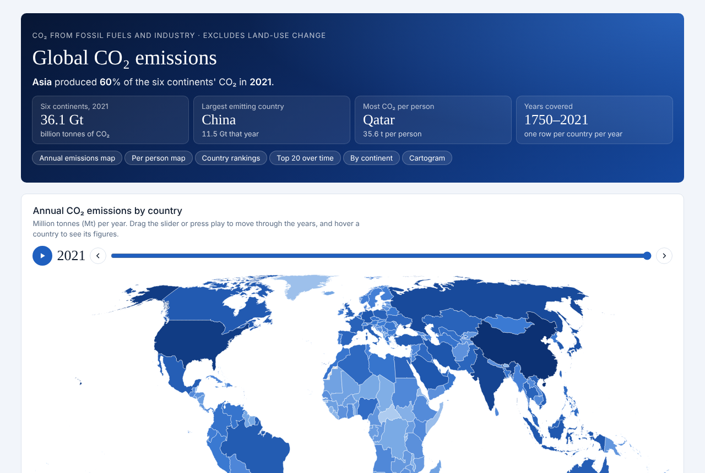

# Global CO₂ Emissions, 1750–2021

An interactive dashboard of annual CO₂ emissions by country and continent, built with D3.js.
Built to show how effectively I can use AI to build data visualisations that allow for problems to be solved or questions to be answered easily.
The dashboard allows easy viewing through different lenses what the global CO2 emissions look like throughout each year from 1750-2021.

### Observations
A note on any observations made. The data that lead to these is incomplete, ie, there is no data for many countries for a large majority of the years so some observations are skewed as a result of this.

An interesting observation from the emissions cartogram is the sheer size of China's emissions. In 2021 summing up the countries in 2nd-6th place total emissions is still 183Mt less than China, showing how much China contributes to global emissions at 30.9% in 2021 and no sign of slowing down. Since 1957 China's emissions have risen by almost 4400% and in comparison USA's has increased by only 76%. Middle Eastern countries have had huge increases also, Saudi Arabia over the same time period has increased emissions by 31,900%, Kuwait 4700% and UAE since 1959 has had emissions of CO" rise by over 1,850,000%.

In 1900 the top 20 CO2 emitters accounted for 97.6% of the world's total CO2 emissions and in 2000 the top 20 accounted for 77.7%, showing 'smaller' countries to either be emitting CO2 at an accelerating rate of 'larger' countries reducing their emissions. Looking at the total emissions by country we can see that 'larger' countries like USA and China did not reduce their emissions in this time period so smaller emitters must have increased their emissions at a faster rate. The reason for this is that they were likely adopting the already-developed technology/equipment used by wealthier countries, causing a spike in their emissions. But, an issue with this observation is that in 1900 there were only 77 countries with available data so the presence of data for more countries may be the reason for this large decrease in share by the top 20

**Live dashboard:** https://joshc386.github.io/GlobalCO2Visual/



## What's in it

| Visual | What it shows | Interaction |
|---|---|---|
| Annual emissions map | Each country shaded by its annual CO₂ (log colour scale, fixed across years) | Year slider, play, hover for figures, click to highlight |
| Per person map | CO₂ per person per year | Year slider, play, hover, click to highlight |
| Country rankings | Rank, annual CO₂, share of world, CO₂ per person, 10-year change | Year slider, sort, search, filter out countries under 1 million people |
| Top 20 over time | Animated bar chart race of each country's share of world CO₂ | Play, speed, year slider; bars coloured by continent |
| By continent | Annual CO₂ for six continents | Drag a window to pick the year range, toggle continents |
| By country | Annual CO₂ for countries you choose, starting with the ten largest historical emitters | Search to add, click to remove, log scale, year-range window, hover to bring a line forward |
| Cartogram | Countries as circles sized by CO₂ (Dorling cartogram) | Single year or all years combined, play, rescale |

Clicking a country on a map, a table row, a circle or a bar highlights it across every chart.

## Data

- **Emissions:** CO₂ from fossil fuels and industry, excluding land-use change, 1750–2021. The columns follow Our World in Data's CO₂ dataset (CC BY 4.0).
- **Country outlines:** Natural Earth 1:50m via [world-atlas](https://github.com/topojson/world-atlas), projected to Equal Earth with d3-geo. Antarctica is left out.
- **Continents:** each country is assigned a continent with `pycountry-convert` (plus a few manual codes). Country totals by continent match the dataset's own continent rows to within 0.1%.

`scripts/prepare_data.py` rebuilds the CSVs in `data/` from the original dataset:

```bash
pip install pandas pycountry pycountry-convert
python scripts/prepare_data.py path/to/visualizing_global_co2_data.csv
```

### Things to know when reading the charts

- Colour scales are logarithmic, so each step in shade is a tenfold change.
- Maps use present-day borders throughout.
- Continent totals exclude international aviation and shipping, which the dataset doesn't assign to a continent. "Share of world" is measured against a world total that includes them.
- The per-person colour scale is capped, because a few tiny territories, such as Sint Maarten in the 1950s, have extreme values.

### Limitations
- Data is not current as of October 2026 (when publishing) and only runs up to the year end of 2021.
- There are many missing data points for each year, especially in the 18th century.
- A lot of figures are estimates rather than actual measurements, predominantly in the earlier years.
- The per-capita plot is filtered to countries with a permanent population of over 1 million to prevent smaller countries and territories from skewing the data simply because of small population.

## Run it locally

Browsers block data files opened straight from disk, so serve the folder:

```bash
python -m http.server
```

Then open http://localhost:8000.

## Built with

[D3.js](https://d3js.org) v7 (bundled in `lib/`), plain HTML, CSS and JavaScript. No build step.
